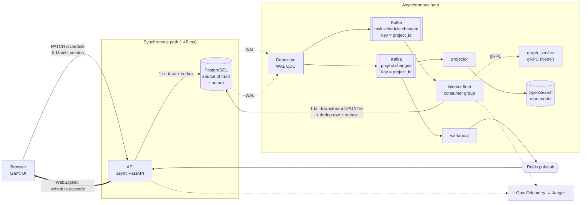
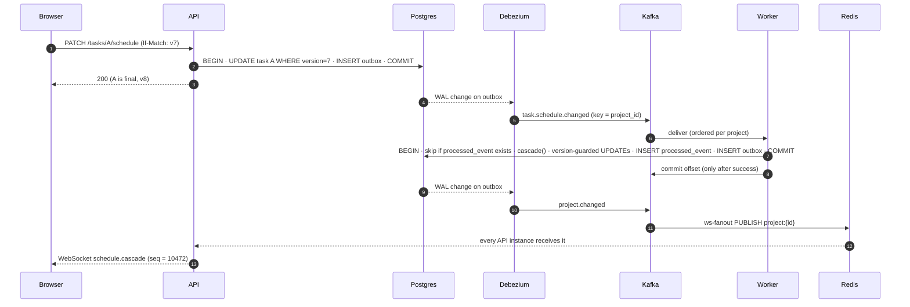
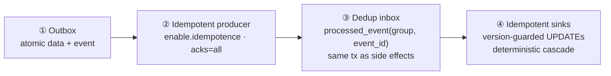

<div align="center">

# ⚡ Workfront Cascade Engine

### An event-driven scheduling backend that reschedules **50,000 dependent tasks in 5.8 seconds**, without ever blocking the user.

*Transactional outbox · CDC · Kafka · effectively-once processing · optimistic concurrency · real-time WebSocket fan-out · distributed tracing*


</div>

---

## The problem

In a work-management platform (think Adobe Workfront), tasks depend on each other. Drag one task on the Gantt chart and every downstream task must slide with it, across hundreds of thousands of tasks, for thousands of tenants, with many people editing the same plan at once.

That is hard because the obvious design fails in four ways:

| Naive approach | What breaks |
|---|---|
| Recompute the cascade inside the HTTP request | A 50k-task cascade holds the user hostage for seconds, and the request times out |
| Write to the DB, then publish to the broker | **Dual-write bug**: a crash between the two loses the cascade forever |
| Let two managers drag the same task | **Lost update**: the last write silently wins |
| Push updates from whichever instance consumed the event | The instance that consumed it is rarely the one holding the user's socket |

This project solves all four, and the design choices are measured, not guessed.

**Target load:** 10M schedule changes/day (about 116/s average, 1–2k/s peak).

---

## Results at a glance

Measured on a single laptop (M4 Pro, 12 cores) with **everything co-located**: 8 API workers, 8 cascade workers, Postgres, Kafka, Debezium, Redis and the load drivers all competing for the same CPUs.

| Metric | Result |
|---|---|
| Sustained throughput | **~582 schedule moves/s**, consumer lag ≈ 0 (about 5,800 cascaded task-writes/s) |
| Headroom vs. target | **~5×** the 10M/day requirement on one oversubscribed machine |
| Mega-cascade | **50,000 tasks rescheduled in 5.81 s (8,602 tasks/s)** |
| API write latency | **45 ms**, and it stays 45 ms even during the mega-cascade |
| Concurrency correctness | 5 simultaneous writers on one task: **exactly 1 wins, 4 get `409`**, version incremented exactly once |

The API returns in 45 ms because it does **not** compute the cascade. It commits the change and an outbox row in one transaction, then returns. The ripple arrives over WebSocket.

---

## Architecture



> **The user-facing contract:** the dragged task confirms immediately with `200`. Its dependents ripple in over WebSocket as one `schedule.cascade` event.

### One request, end to end



---

## System design decisions

Each row is a real fork in the road, with the reason it went the way it did.

| # | Problem | Pattern chosen | Rejected alternative | Why |
|---|---|---|---|---|
| 1 | Atomically change data **and** emit an event | **Transactional Outbox** | Publish to Kafka directly after commit | Removes the dual-write failure mode. The event exists if and only if the data change committed. |
| 2 | Get outbox rows into Kafka | **Debezium CDC** on the Postgres WAL, with the Outbox Event Router SMT | A polling relay | No polling load, ordered by WAL, routes by `event_type`, and the producer is idempotent (`acks=all`). |
| 3 | Ordering without a global lock | **Partition key = `project_id`** | A distributed lock per project | One project maps to one partition and one consumer, so cascades are serialized per project and parallel across projects. Concurrency control comes for free from the log. |
| 4 | Exactly-once delivery | **Effectively-once** = idempotent producer + **dedup inbox** + idempotent sinks | Kafka transactional EOS | EOS only spans Kafka→Kafka. Our sinks are Postgres and OpenSearch, so we make a redelivery harmless instead of preventing it. |
| 5 | Lost updates on concurrent edits | **Optimistic locking**: `version` in the SQL `WHERE`, `If-Match` header, `409`/`428` | Check the version in application code | An app-level check is a TOCTOU race. Putting the version in the `UPDATE ... WHERE` makes the database the arbiter. |
| 6 | A human edits a task mid-cascade | **Optimistic worker + Kafka redelivery**: on `StaleDataError`, roll back and seek back | Pessimistic `SELECT ... FOR UPDATE` | Self-healing with no held locks. The worker recomputes against fresh state. |
| 7 | Consumer instance ≠ socket-holding instance | **Redis pub/sub bridge**: Kafka → Redis → every API instance | Sticky routing, or one Kafka group per API instance | Broadcast makes the problem disappear and keeps the API stateless. |
| 8 | Client misses or reorders events | **Per-project monotonic `seq`**, with a `seq` cursor on `GET /gantt` | Trusting the socket | Client ignores stale events and refetches on a gap. |
| 9 | Testing the scheduling math | **Pure function core** (`cascade.py`: no I/O, no framework) | Logic inside the Kafka consumer | Unit-testable with zero infrastructure. Handles all four dependency types with lag. |
| 10 | Poison messages | **DLQ topic** (`*.dlq`), with the offset committed past the bad message | Infinite retry | One bad event can't wedge a partition. |
| 11 | IDs at scale | **UUIDv7** (hand-rolled, RFC 9562) | UUIDv4 / bigint | Time-ordered keeps B-tree inserts append-mostly, and the IDs are globally unique across services. |
| 12 | Per-tenant custom fields | **JSONB** + generated columns for hot fields | EAV tables | No self-join explosion. Flexible but still indexable. |
| 13 | Multi-tenancy | **Shared tables, `customer_id` leads every index** | Database-per-tenant | Scales to many tenants, and you can shard on `customer_id` later. |
| 14 | One request crosses an async boundary | **W3C `traceparent` injected into the outbox payload** | Separate traces per service | One trace spans API → outbox → Debezium → Kafka → worker in Jaeger. |

### The effectively-once pipeline

Four layers stack to give exactly-once *effects* over at-least-once *delivery*:



The dedup row, the downstream task updates and the next outbox event are written in **one Postgres transaction**. The Kafka offset is committed **only after** that transaction succeeds. A crash at any point yields either "nothing happened" or "everything happened". A redelivery finds its `processed_event` row and skips.

### The cascade algorithm

`services/worker/src/cascade.py` is a pure constraint-propagation function over the affected DAG. It supports all four dependency types, each with lag (negative allowed):

| Type | Constraint |
|---|---|
| `FS` finish-to-start | `successor.start ≥ predecessor.finish + lag` |
| `SS` start-to-start | `successor.start ≥ predecessor.start + lag` |
| `FF` finish-to-finish | `successor.finish ≥ predecessor.finish + lag` |
| `SF` start-to-finish | `successor.finish ≥ predecessor.start + lag` |

Tasks keep their duration and slide as a whole. Processing runs in topological order, only tasks whose dates actually changed are returned, and a cycle raises `DependencyCycleError`.

---

## Real-time contract

Server-to-client push over `/ws`, in a shared envelope:

```jsonc
{ "type": "schedule.cascade", "project_id": "019e…", "seq": 10472, "ts": "2026-…Z",
  "data": { "origin_task_id": "…", "changes": [{ "task_id": "…", "planned_start": "…", "planned_completion": "…", "version": 9 }] } }
```

`seq` is monotonic per project. The client ignores lower values and refetches the Gantt if it sees a gap. Full REST and WebSocket contract: [`docs/api-contract.md`](docs/api-contract.md).

---

## Performance engineering

The load test found its bottlenecks in this order. The process is the point: *measure, find the real constraint, fix it, repeat.*

| # | Bottleneck found | Fix |
|---|---|---|
| 1 | **The load generator itself** (one async Python process caps at ~190 req/s) | Six driver processes unlocked ~582/s. Always check the tool isn't what you're measuring. |
| 2 | **One core per uvicorn worker** | Scale API horizontally across workers and replicas |
| 3 | **Connection-pool starvation**: 5 default connections queued 300 requests, p99 hit 6 s | Pool raised to 40+20, Postgres `max_connections` to 300 |
| 4 | **The worker fleet was never the bottleneck**: 8 workers over 12 partitions held lag ≈ 0 | None needed |
| 5 | **Mega-cascade is serial per project by design** | Accepted. One giant transaction, and the API still returned in 45 ms |

### Known ceilings (and the planned answer)

| Ceiling | Mitigation |
|---|---|
| Single Postgres primary saturates on writes first | Read replicas, then range partitioning, then sharding by `customer_id` |
| Single Debezium connector reading the WAL | Multiple connectors / partitioned capture |
| Partition count caps parallel cascades | Over-provision partitions (12–48) |
| An 8 MB `project.changed` event for a 50k cascade killed a Debezium task | Band-aid: raised `max.request.size`. Real fix: **chunk the event** |
| Worker loads the whole project per event (O(project)) | The reason `graph_service` / Neo4j exists in the design |

---

## War stories

Bugs found and fixed while building and load-testing:

- **Optimistic-lock TOCTOU.** The version check lived in Python, so two writers both passed it. Moved to SQLAlchemy `version_id_col`, which puts the version in the `UPDATE ... WHERE`.
- **`redis.asyncio` `listen()` hung on Redis 8.** Replaced with `get_message(timeout=)` inside a resilient reconnect loop.
- **Debezium EventRouter rejected `created_at`** (`not INT64`). Dropped the event-timestamp mapping.
- **Connection-pool starvation** (see above), diagnosed from a p99 spike to 6 s.
- **UTC drift.** Pinned every DB connection to UTC so the wire format is consistent.

---

## Observability: the "God View"

| Signal | Tool | Answers |
|---|---|---|
| Distributed traces | OpenTelemetry → **Jaeger** (`:16686`) | Where did this drag spend its time across API → Kafka → worker? |
| Consumer lag | **Kafka UI** (`:8080`) and `tests/perf/monitor.sh` | Is the worker fleet keeping up? (the key health metric) |
| Replication-slot lag | `monitor.sh` (`pg_replication_slots`) | Is Debezium keeping up with the WAL? |
| Pub/sub fan-out | **RedisInsight** (`:5540`) | Are `project:*` events flowing? |

---

## Testing

| Test | Proves |
|---|---|
| `tests/test_concurrency.py` | 5 concurrent writers produce exactly 1 × `200` and 4 × `409`, and the version increments once. A stale `If-Match` gets `409`, a missing one gets `428`. |
| `tests/test_worker_handler.py` | The cascade handler against real Postgres, including redelivery being a no-op |
| `tests/test_pipeline_e2e.py` | The full path from PATCH through outbox, Debezium, Kafka, worker and back to the data |
| `tests/test_api_contract.py` | REST + WebSocket wire contract |
| `tests/perf/` | `seed.py` (80k tasks via Postgres `COPY` in ~3 s), `load.py` (multi-process driver), `cascade_bench.py` (mega-cascade), `monitor.sh` |

---

## Repository map

```
.
├── libs/wf_core/              # shared kernel: models, UUIDv7, DB engines, events, telemetry, Alembic migrations
├── services/
│   ├── api/                   # async FastAPI: REST + WebSocket, optimistic locking, outbox writes
│   ├── worker/                # Kafka consumer → dedup → cascade → version-guarded write-back
│   │   ├── cascade.py         #   pure constraint-propagation engine (no I/O)
│   │   ├── handler.py         #   one transaction: dedup + writes + outbox
│   │   └── consumer.py        #   manual offsets, redelivery on conflict, DLQ
│   ├── ws_fanout/             # Kafka project.changed → Redis pub/sub
│   ├── graph_service/         # gRPC subgraph service (contract defined; Neo4j impl is a stub)
│   └── projector/             # CQRS read-model → OpenSearch (stub)
├── proto/scheduling.proto     # internal gRPC contract: worker ↔ graph_service
├── debezium/                  # outbox connector config (EventRouter SMT)
├── docker-compose.yml         # Kafka (KRaft), Kafka Connect/Debezium, Redis, Jaeger, Kafka UI, RedisInsight
├── docs/                      # api-contract.md · event-flow.md · the design book
└── tests/                     # correctness + perf harness
```

### What is built vs. deferred

| Built and tested | Defined, implementation deferred |
|---|---|
| Postgres schema + migrations, async API, outbox → Debezium → Kafka → worker, dedup inbox, Redis fan-out, optimistic locking, OpenTelemetry/Jaeger, perf harness | `graph_service` → Neo4j (the worker currently loads the subgraph from Postgres, and the cascade math is identical), `projector` → OpenSearch |

---

## Run it locally

```bash
# 1. Infrastructure (Kafka KRaft, Debezium, Redis, Jaeger, UIs)
docker compose up -d

# 2. Postgres needs logical replication for CDC:   wal_level = logical
#    then apply the schema
cd libs/wf_core && alembic upgrade head && cd ../..

# 3. Register the outbox connector
curl -X POST -H 'Content-Type: application/json' \
     --data @debezium/register-outbox.json http://localhost:8083/connectors

# 4. Services (copy .env.example → .env first)
python main.py                          # API on :8000
python -m services.worker.src.consumer  # worker fleet
python -m services.ws_fanout.src.main   # Kafka → Redis bridge

# 5. Prove it
python tests/test_concurrency.py        # one writer wins, the rest get 409
python tests/perf/seed.py && python tests/perf/cascade_bench.py   # 50k-task cascade
```

---

## Deeper reading

A full design book lives in [`docs/book/`](docs/book/00-index.md). It has 19 chapters covering the data model, eventing core, concurrency, real-time fan-out, observability, performance, and a comparative treatment of microservices, messaging, caching, datastores, webhooks at scale and CI/CD. It also includes a [decision log](docs/book/appendix/19-glossary-and-decision-log.md) with the alternative rejected and the reason for every choice above.

For the event topology and worker algorithm, see [`docs/event-flow.md`](docs/event-flow.md).

---

<div align="center">

**Designed and built by Armen Madoyan**

*Every number above comes from a benchmark in this repo, and every decision has a file you can open.*

</div>
